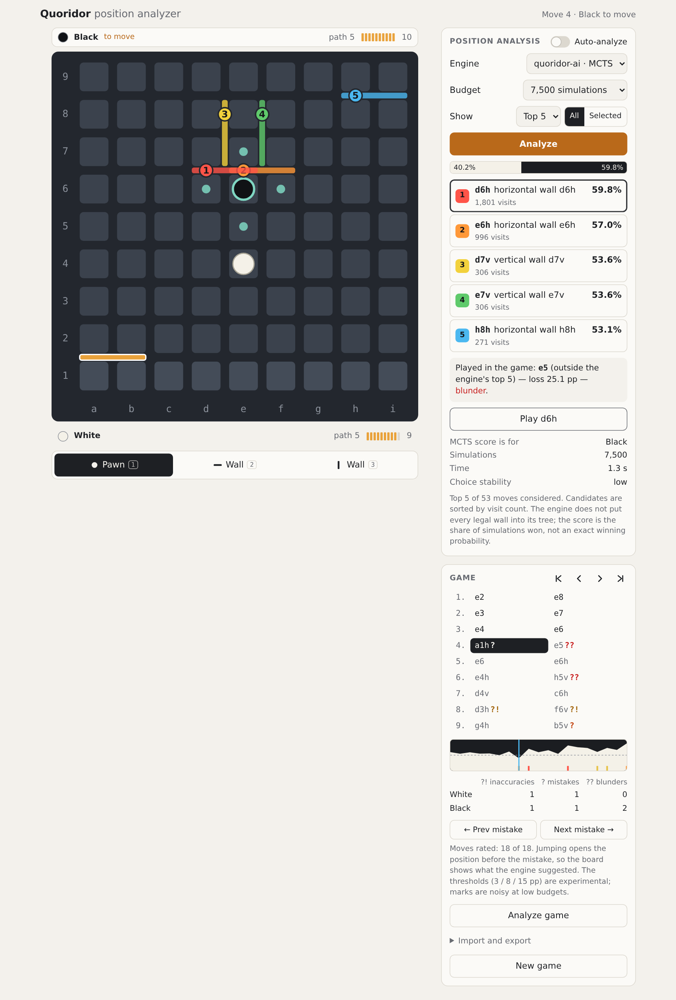

# Quoridor Analyzer

A browser-based analysis board for [Quoridor](https://en.wikipedia.org/wiki/Quoridor): play through a
game with full rule checking, ask an engine for its top candidate moves, and review a whole game for
inaccuracies, mistakes and blunders.

It is plain HTML, CSS and JavaScript — no build step, no framework, no runtime dependencies — and
engines are pluggable: the GUI only talks to a small `Engine` interface, so you can add your own.



## Features

- **Legal board** — 9×9 board, pawn moves with jumps, wall placement with all checks (overlap, crossing,
  walls left, never blocking the last path). Illegal actions are refused with a reason.
- **History** — undo/redo, a clickable move list, jump to any position; a new move made from the middle
  of the history replaces the old continuation.
- **Position analysis** — top 1–5 candidates with score and visit count, colour-coded on the board
  (red, orange, yellow, green, blue), "show all" or "show only the selected one", one-click play.
- **Auto-analyze** — optionally analyze every position you open. Results are cached per position and engine.
- **Game review** — import a game as text, analyze every position, get `?!` / `?` / `??` marks, a score
  graph, a per-player summary and previous/next-mistake navigation.
- **Two engines out of the box**
  - `quoridor-ai · MCTS` — the Monte Carlo tree search from
    [gorisanson/quoridor-ai](https://github.com/gorisanson/quoridor-ai), run "raw" (without the
    opening-book and other overrides its playing bot applies).
  - `Alpha-beta search` — a small, independent exhaustive search with a shortest-path heuristic. It is
    weaker than the MCTS; it mainly exists as a second, structurally different engine and as a template.
- Engines run in Web Workers, so the page stays responsive and any analysis can be cancelled.
- Works on phones (single-column layout) and follows the system light/dark theme.

## Quick start

You need a local web server: ES modules and Web Workers do not work from `file://`.

```bash
git clone <your-fork-url> quoridor-analyzer
cd quoridor-analyzer
npm start                # runs scripts/serve.mjs — needs Node.js 18+, installs nothing
```

Then open <http://localhost:8000>. To use another port: `node scripts/serve.mjs 3000`.

No Node.js? Any static server works, as long as it is started **inside the project folder**:

```bash
python -m http.server 8000     # Windows: use `python` or `py`; `python3` is often just a Store stub
python3 -m http.server 8000    # macOS / Linux
npx serve -l 8000
```

### Tests

```bash
npm test
```

This runs `test/crosscheck.mjs` in Node (no browser needed). It plays 300 random games and checks
that this project's rules produce exactly the same legal moves as the rules model inside quoridor-ai,
then smoke-tests the history, notation/import, move evaluation, both engines and the engine registry.
It takes about 20 seconds.

### Deploying

The project is a static site. Upload the folder as-is to any static host. For GitHub Pages:
*Settings → Pages → Deploy from a branch →* your branch, folder `/ (root)`.

## Using the app

### Playing moves

| Action | How |
| --- | --- |
| Move the pawn | Click one of the highlighted squares |
| Place a wall (mouse) | Click the gap between two squares — a preview shows where the wall will go |
| Place a wall (touch or precise) | Switch to a **Wall** mode (horizontal or vertical) and tap a crossing |
| Switch mode | `1` pawn, `2` horizontal wall, `3` vertical wall |
| Step through the game | `←` / `→`, the arrow buttons, or click a move in the list |
| Cancel a running analysis | `Esc` or the cancel button |

White starts at the bottom and moves first. Each player card shows the walls left and the current
shortest path to the goal.

### Analyzing a position

1. Pick an **Engine** and a **Budget** (simulations for MCTS, search depth for alpha-beta).
2. Press **Analyze**, or switch on **Auto-analyze** to do it for every position you open.
3. The candidates appear in the panel and on the board. Click a candidate to select it; use
   **Show: All / Selected** to declutter the board; **Play …** plays the selected candidate.

Things worth knowing when reading the numbers:

- The **MCTS score** is the share of simulations the side to move won after that move. It is not an
  exact winning probability, and it changes somewhat from run to run.
- MCTS candidates are sorted by **visit count** (the engine's own criterion), not by score. A move
  with few visits has an unreliable score and is flagged.
- quoridor-ai does not put every legal wall into its search tree, so "top 5" means the top 5 *of the
  moves it considered*.
- Alpha-beta percentages are a heuristic mapped onto 0–100% and are **not comparable** with MCTS percentages.

### Reviewing a game

1. Open **Import and export**, paste the moves and press **Load game** (or simply play the game on the board).
2. Press **Analyze game**. Marks appear in the move list as positions are finished. You can browse
   while it runs; changing the game cancels it.
3. Use **Next mistake / Prev mistake** or click the graph. You land on the position *before* the
   mistake, so the board shows what the engine preferred and the panel shows how much the played move lost.

How a move is rated: `loss = score of the engine's best move − score of the position after the played move`.
The position after the played move is searched separately with the full budget, so a move is never
called bad merely because the search from the previous position barely looked at it. Thresholds:
under 3 percentage points is fine, 3–8 `?!` inaccuracy, 8–15 `?` mistake, 15+ `??` blunder.

These thresholds are **experimental**, and with MCTS the marks are noisy at low budgets — use 20,000
simulations or more for a review you intend to trust.

### Notation

Files `a`–`i` run left to right, ranks `1`–`9` bottom to top (White starts on `e1`, Black on `e9`).

| Text | Meaning |
| --- | --- |
| `e2` | Pawn moves to e2 |
| `e3h` | Horizontal wall; the crossing it is centred on has e3 as its lower-left square (the wall lies above e3 and f3) |
| `e3v` | Vertical wall at the same crossing (to the right of e3 and e4) |

A game is a whitespace-separated list of moves; move numbers are optional: `1. e2 e8 2. e3 d7h …`

## Project structure

```
index.html, style.css      page and styles
scripts/serve.mjs          dependency-free dev server
src/
  core/                    engine-independent game model (no DOM)
    position.js            Position format, initial position, hashing
    move.js                Move format
    rules.js               ALL legality checks, applying moves, shortest paths
    game.js                history: applyMove / undo / redo / goTo / load
    notation.js            move <-> text, game import/export
  engines/
    engine.js              the Engine interface and the AnalysisResult format
    worker-engine.js       base class for engines that compute in a Web Worker
    engine-manager.js      engine registry and selection
    quoridor-ai-engine.js  MCTS adapter
    path-alphabeta-engine.js, minimax/search.js   the alpha-beta engine
  workers/
    analysis-worker.js     runs quoridor-ai's MCTS (classic worker)
    minimax-worker.js      runs the alpha-beta search (module worker)
  analysis/
    analyzer.js            analysis on top of the selected engine + result cache
    evaluation.js          position value, move loss, mistake classes, stability
  ui/
    board-view.js          SVG board: rendering and click -> Move
    main.js                panels, history list, game review, events, engine registration
test/crosscheck.mjs        tests (Node)
vendor/quoridor-ai/        unmodified game.js and ai.js from gorisanson/quoridor-ai (MIT)
```

The dependency direction is strict: `core` knows nothing about engines or the DOM; engines know
`core` only; the UI knows `core`, `analysis` and the `Engine` interface, but nothing about how any
particular engine represents moves or positions.

### Data formats

**Position**

```js
{
  pawns: [{ row, col, walls }, { row, col, walls }], // player 0 = White, player 1 = Black
  walls: { horizontal: [{ row, col }], vertical: [{ row, col }] },
  turn: 0,       // side to move
  ply: 0,        // plies played so far
  winner: null   // null | 0 | 1
}
```

Squares use `row` 0–8 from the top and `col` 0–8 from the left. White starts on row 8 and wins on
row 0. A wall anchor `(row, col)` with values 0–7 is the crossing between squares `(row, col)` and
`(row+1, col+1)`; a horizontal wall there blocks rows `row`↔`row+1` in columns `col` and `col+1`, a
vertical one blocks columns `col`↔`col+1` in rows `row` and `row+1`.

**Move**

```js
{ type: "pawn", to: { row, col } }
{ type: "wall", orientation: "horizontal" | "vertical", row, col }
```

**AnalysisResult** (what every engine returns)

```js
{
  engine, budget, positionHash, sideToMove,  // filled in by WorkerEngine
  simulations,       // amount of work done (simulations, nodes, …) — shown in the panel
  elapsedMs,
  totalCandidates,   // how many root moves the engine considered
  rootValue,         // value of the position for the side to move, 0..1
  candidates: [      // best first, at most 5 are used
    { rank, move, visits, wins, winRate }   // winRate: 0..1 for the side to move, after this move
  ]
}
```

## Adding your own engine

An engine is any object with this interface (`src/engines/engine.js`):

```js
getInfo()                                  // static description, see below
analyze(position, { budget, onProgress })  // -> Promise<AnalysisResult>
stop()                                     // cancel; the pending promise must reject with EngineCancelled
```

`getInfo()` tells the GUI how to present the engine:

| Field | Purpose |
| --- | --- |
| `id` | Unique id; used for the cache and the saved selection |
| `name` | Shown in the engine dropdown |
| `scoreLabel` | What the percentage is called, e.g. `"MCTS score"` |
| `sampling` | `true` if scores are statistical — enables the "few visits" flag and the stability row |
| `units` | `{ work, visits }` — labels for `simulations` and `candidate.visits`, e.g. `{ work: "Nodes", visits: "nodes" }` |
| `budgetLabel`, `budgets`, `defaultBudget` | The budget dropdown: label, `[{ value, label }]`, default value. A **larger value must mean a stronger analysis** (the cache relies on it) |
| `note` | One or two sentences shown under the results: what the numbers mean and their caveats |

### Option A: an engine that runs in a Web Worker (recommended)

1. **Write the worker**, e.g. `src/workers/my-worker.js`:

   ```js
   import { Rules } from "../core/rules.js"; // optional: reuse the rules

   onmessage = ({ data }) => {
     if (data.type !== "analyze") return;
     try {
       const started = Date.now();
       const { position, timeMs } = data;   // `timeMs` comes from workerParams() below
       // ... search; call postMessage({ type: "progress", value: 0..1 }) now and then ...
       postMessage({
         type: "analysis-result",
         result: {
           simulations: 12345,
           elapsedMs: Date.now() - started,
           totalCandidates: 42,
           rootValue: 0.57,
           candidates: [
             { rank: 1, move: { type: "pawn", to: { row: 7, col: 4 } }, visits: 9000, wins: null, winRate: 0.58 },
           ],
         },
       });
     } catch (e) {
       postMessage({ type: "error", message: String(e.message || e) });
     }
   };
   ```

2. **Write the adapter**, e.g. `src/engines/my-engine.js`:

   ```js
   import { WorkerEngine } from "./worker-engine.js";

   export class MyEngine extends WorkerEngine {
     getInfo() {
       return {
         id: "my-engine",
         name: "My engine",
         scoreLabel: "Score",
         sampling: false,
         units: { work: "Nodes", visits: "nodes" },
         budgetLabel: "Time",
         budgets: [{ value: 1000, label: "1 second" }, { value: 5000, label: "5 seconds" }],
         defaultBudget: 1000,
         note: "What the score means and what it does not.",
       };
     }
     createWorker() {
       return new Worker(new URL("../workers/my-worker.js", import.meta.url), { type: "module" });
     }
     workerParams(budget) { return { timeMs: budget }; } // merged into the "analyze" message
   }
   ```

   `WorkerEngine` handles progress, errors and cancellation (it terminates the worker), and adds
   `engine`, `budget`, `positionHash` and `sideToMove` to the result.

3. **Register it** in `src/ui/main.js`:

   ```js
   const engines = new EngineManager()
     .register(new QuoridorAiMctsEngine())
     .register(new PathAlphaBetaEngine())
     .register(new MyEngine());
   ```

That is all: the dropdown, budget list, cache, auto-analysis and game review pick it up.

The existing engines are the two reference implementations: `analysis-worker.js` shows how to wrap a
third-party engine with its own position format (convert `Position` in, convert moves out), and
`minimax/search.js` shows an engine written directly against `core/Rules`.

### Option B: an engine that runs elsewhere (server, WebAssembly, native via HTTP)

Extend `Engine` directly. For example, a remote engine:

```js
import { Engine, EngineCancelled } from "./engine.js";
import { positionHash } from "../core/position.js";

export class RemoteEngine extends Engine {
  getInfo() { /* as above */ }

  async analyze(position, { budget }) {
    this.stop();
    const controller = (this.controller = new AbortController());
    try {
      const response = await fetch("/api/analyze", {
        method: "POST",
        headers: { "Content-Type": "application/json" },
        body: JSON.stringify({ position, budget }),
        signal: controller.signal,
      });
      if (!response.ok) throw new Error(`server replied ${response.status}`);
      const result = await response.json();
      return { ...result, engine: this.getInfo().id, budget, positionHash: positionHash(position), sideToMove: position.turn };
    } catch (e) {
      throw controller.signal.aborted ? new EngineCancelled() : e;
    }
  }

  stop() { if (this.controller) this.controller.abort(); }
}
```

### Rules your engine's results must follow

- `winRate` and `rootValue` are in **0..1 from the point of view of the side to move** in the analyzed position.
- `candidates` are sorted **best first**; `candidates[0]` is treated as the engine's choice.
- `rootValue` should be consistent with candidate scores: the game review compares
  `candidates[0].winRate` of one position with `1 − rootValue` of the next. For a minimax-style
  engine use the best candidate's score; for MCTS use the root's overall win rate.
- Return only **legal** moves in the `Move` format above. If your engine implements different rule
  variants, convert or filter in the adapter.
- `analyze()` is never called for finished games.

## Customizing

| I want to change… | Look at |
| --- | --- |
| Mistake thresholds and their names | `LOSS_CLASSES` in `src/analysis/evaluation.js` |
| How a played move is rated | `moveLoss()` in `src/analysis/evaluation.js` |
| MCTS budgets or the exploration constant (`uctConst`) | `src/engines/quoridor-ai-engine.js` |
| The alpha-beta heuristic or depths | `src/engines/minimax/search.js`, `src/engines/path-alphabeta-engine.js` |
| How many candidates engines return (5) | `MAX_CANDIDATES` in both workers' search code, and the `Top N` options in `index.html` |
| Colours, rank colours, layout | CSS variables at the top of `style.css` (`--r1`…`--r5`, `--wall`, …) |
| Board drawing or click handling | `src/ui/board-view.js` |
| UI wording | `index.html`, `src/ui/main.js`; engine texts live in each engine's `getInfo()`; rule messages in `src/core/rules.js` |
| The rules themselves | `src/core/rules.js` — note that the vendored MCTS has its own copy of the rules, and `npm test` will report any divergence |

## Known limitations and ideas

- quoridor-ai's MCTS considers only "probable" walls; a mode that expands all legal walls is not implemented.
- MCTS results are not reproducible (no fixed random seed) and no confidence interval is shown.
- Analysis is single-threaded: one worker, one position at a time.
- Only game-history editing is supported — there is no free position editor.
- The analysis cache lives in memory and is lost on reload; games are not saved automatically
  (use **Import and export**).
- There is no automated browser test; `npm test` covers the logic, not the UI.

## Browser support

Current versions of Chrome, Edge, Firefox and Safari. The alpha-beta engine uses a module worker
(Firefox 114+, Safari 15+).

## Credits and license

- MCTS engine and its rules model: [gorisanson/quoridor-ai](https://github.com/gorisanson/quoridor-ai)
  by Kyutae Lee, MIT License. The two files in `vendor/quoridor-ai/` are unmodified.
- Quoridor is a board game designed by Mirko Marchesi and published by Gigamic. This project is not
  affiliated with them.

This project is released under the [GPL-3.0-or-later](LICENSE) license.
